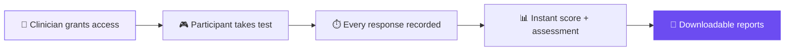
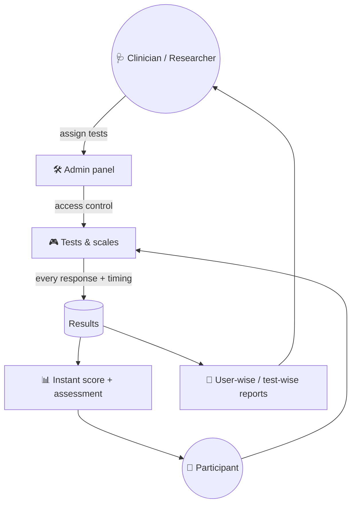

# 🧠 SynapSych-Cognitive-Testing-System 

### Cognitive testing and clinical screening, from anywhere.

A web-based platform for clinicians and researchers to assess **attention, memory, impulse control and reaction speed**, remotely or on-site. Every participant gets an overall score and a personalised assessment **the moment they finish a test**.

---

## ⚡ The problem → the fix

> Traditional cognitive testing needs the participant in the room, a clinician timing by hand, and hours of scoring afterwards.

**Synapsych** puts 16 validated tests in the browser. Every response is timed and recorded, scored automatically, and turned into user-wise or test-wise reports.

---

## 🎮 Cognitive tests

Interactive, game-based tasks with real-time feedback.

| | Test | Measures | The task |
|:-:|---|---|---|
| 🔍 | **Visual Search** | Visual attention, processing speed | Find the target **O** among **X** distractors |
| 🔢 | **Digit Span** | Short-term and working memory | Recall digit sequences, **forward and reverse** |
| ⛔ | **Go / No-Go** | Impulse control, attention | Respond to *Go*, hold back on *No-Go* |
| 🚦 | **Choice Reaction Time** | Decision speed, accuracy | Click Red or Green to match the prompt, timed in **ms** |
| 🎨 | **Stroop** | Selective attention, flexibility | Name the ink colour when the word says otherwise |
| 🔗 | **Trail Making (A & B)** | Task switching, visual attention | Connect 1-2-3… then 1-A-2-B… |
| 🗣️ | **Verbal Learning** | Verbal memory, language | Learn and recall a word list across trials |
| 🏗️ | **Tower of Hanoi** | Planning, executive function | Move the disk stack in as few moves as possible |

---

## 📋 Clinical screening scales

Standard questionnaires, scored and interpreted automatically.

> 📘 Data collected and feedback for every test and scale are in the **[full documentation](https://docs.google.com/document/d/1KZmfGBde86sarcK2dq3hSqRE46HU1qjh/edit)**.

| | Scale | Screens for | Who |
|:-:|---|---|---|
| 🧠 | **PHQ-9** | Depression severity | Adults |
| 😟 | **GAD-7** | Anxiety | Adults |
| ⚡ | **ASRS v1.1** | ADHD | Adults |
| 📋 | **Vanderbilt** | ADHD and related conditions | Children (parent / teacher) |
| 👧 | **SCARED** | Anxiety disorders | Children and teens |
| 👶 | **M-CHAT-R** | Autism risk | Toddlers (parent-reported) |
| 🧩 | **RPQ** | Post-concussion symptoms | Adults |
| 🧠 | **SMMSE** | Cognitive impairment (30-point) | Adults |

---

## ✨ Platform features

| | Feature | What it does |
|:-:|---|---|
| 🔐 | **Secure login & access control** | Clinicians decide which tests each user can take |
| ⚡ | **Instant results** | Overall score and personalised assessment right after each test |
| ⏱️ | **Detailed performance data** | Reaction times, errors, misses, moves and efficiency for every attempt |
| 🛠️ | **Admin panel** | Manage users, grant access and monitor completed tests with timestamps |
| 📄 | **User-wise & test-wise reports** | Downloadable for analysis and documentation |
| 🌍 | **Remote or in-clinic** | Same tests, same data, wherever the participant is |

---

## 🎯 Use cases

| 💊 Pre/post treatment | 📈 Baseline & progress | 🩺 Clinical evaluation | 🔬 Research |
|:-:|:-:|:-:|:-:|
| Measure the change a treatment makes | Screen once, track over time | ADHD, dementia and neurological | Cognitive studies and experiments |

---

## 🏗️ How it works

---

## 👨‍💻 My role

- **Assessment engine:** built the 8 game-based cognitive tests and 8 clinical scales, with scoring and automated interpretation
- **Dashboards & admin panel:** user management, test access control and completion monitoring
- **Backend APIs:** services behind tests, results and reports
- **Reporting:** user-wise and test-wise downloadable reports
- **UX:** calm, distraction-free test flow for participants of every age, from toddlers' parents to older adults

---

**🔗 [synapsych.com](https://synapsych.com)** · **📘 [Full documentation](https://docs.google.com/document/d/1KZmfGBde86sarcK2dq3hSqRE46HU1qjh/edit)** · **More of my work: [github.com/MSSohan](https://github.com/MSSohan)**

The production source code is private. This repository is a showcase of the project.

